 
 

  Hola, soy <strong>Amilcar</strong>, desarrollador de software Full Stack. 
  Me apasiona transformar ideas en soluciones digitales.

---

## 01 / PERFIL

<table>
<tr>
<td width="70%" valign="top">

### Diseño y construyo productos digitales completos.

Interfaces claras, sistemas sólidos, APIs e integraciones que convierten ideas en experiencias útiles.

Trabajo de extremo a extremo —desde el análisis y la arquitectura hasta el despliegue— con especial atención en la lógica backend, el diseño de APIs y la conexión entre plataformas, datos y equipos.

Tengo **dos años de experiencia** diseñando y desarrollando sistemas, desde su planificación y arquitectura hasta su implementación y despliegue.

> **La curiosidad me lleva a aprender. El deseo de crear me impulsa a ponerlo en práctica.**

</td>
<td width="30%" align="center" valign="middle">

</td>
</tr>
</table>

## 02 / LO QUE CONSTRUYO

|  |  |
|---|---|
| **01 — PRODUCTOS WEB**  Aplicaciones completas, paneles administrativos, sitios públicos y módulos de gestión pensados para necesidades reales. | **02 — BACKEND & APIs**  Servicios modulares, APIs REST, autenticación, permisos, validaciones y lógica de negocio mantenible. |
| **03 — DATOS & AUTOMATIZACIÓN**  Modelado relacional, procesamiento de información, reportes, IA, webhooks y flujos conectados. | **04 — INTEGRACIONES & DEPLOY**  Google Workspace, mensajería, servicios externos, Railway y mantenimiento de entornos. |

## 03 / STACK TÉCNICO

### Frontend

### Backend & datos

### Integraciones, IA & herramientas

## 04 / CÓMO TRABAJO

| 01 | 02 | 03 |
|:---|:---|:---|
| **Resolución de problemas** | **Aprendizaje continuo** | **Adaptabilidad** |
| **Responsabilidad y autonomía** | **Proactividad** | **Pensamiento lógico y analítico** |

Además del stack técnico, aporto criterio, constancia y autonomía para convertir requerimientos en soluciones que el equipo pueda comprender, utilizar y mantener.

## 05 / AHORA

<table>
<tr>
<td width="64%" valign="top">

Actualmente trabajo como **Desarrollador Web Full Stack** en Code, participando en el ciclo completo de producto: análisis, arquitectura, interfaz, implementación, integración, despliegue y mantenimiento.

<pre lang="yaml"><code>enfoque:
  - productos web full stack
  - arquitectura backend y APIs
  - automatización e integraciones
  - experiencias de usuario claras

aprendiendo: "mejorar cada sistema con el siguiente problema real"
estado: "listo para crear"</code></pre>

</td>
<td width="36%" align="center" valign="middle">

</td>
</tr>
</table>

---

### ¿Tienes una idea? [Hablemos.](mailto:amilcar.xicay@indevelop.net)

Diseño, código y café desde Guatemala.

